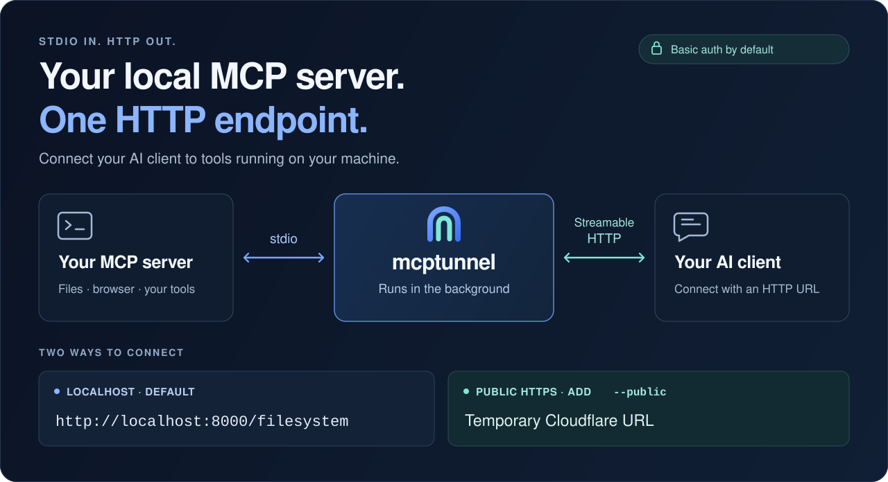

<p align="center">
  
</p>

<h1 align="center">mcptunnel</h1>

<p align="center">
  Your stdio MCP servers, reachable over HTTP.
</p>

<p align="center">
  <a href="#why-do-you-need-this">Why mcptunnel?</a> ·
  <a href="#run">Run</a> ·
  <a href="#install">Install</a> ·
  <a href="#connect-your-client">Connect your client</a> ·
  <a href="docs/USER_GUIDE.md">Documentation</a>
</p>

<p align="center">
  
</p>

## Why do you need this?

Your AI client may run somewhere your tools cannot: your files are on your laptop, or your company wiki is only reachable through your work VPN. **mcptunnel lets the client call an MCP server running on your machine over HTTP.** The tools run there, and their results go back to the client.

- **Local files:** expose an MCP server with access to a folder you choose.
- **Work VPN:** run an MCP server on your VPN-connected machine to access an internal wiki or service. The machine must stay connected, and its network must allow the outbound tunnel. Use tools and data your organization permits the external AI service to access.

<a id="quick-start"></a>

## Run

**Turn a local MCP server into an HTTP endpoint.** [Install mcptunnel](#install), then try this read-only folder example (requires [Node.js 22+](https://nodejs.org/en/download)):

```sh
mkdir mcptunnel-demo
printf 'Hello from mcptunnel!\n' > mcptunnel-demo/hello.txt
mcptunnel run --allow-tool read_text_file --allow-tool list_directory -- \
  npx -y @modelcontextprotocol/server-filesystem@2026.8.31 ./mcptunnel-demo
# → http://localhost:8000/filesystem
```

In your AI client's **Streamable HTTP** settings, paste the printed URL and set the `Authorization` header to the printed `Basic …` value. Ask it to list the directory and read `hello.txt`. Only reading files and listing directories are allowed.

**Connecting from a remote AI service? Add `--public`** to get a temporary HTTPS URL:

```sh
mcptunnel run --public --path /public-files \
  --allow-tool read_text_file --allow-tool list_directory -- \
  npx -y @modelcontextprotocol/server-filesystem@2026.8.31 ./mcptunnel-demo
# → https://<random>.trycloudflare.com/public-files
```

Use the URL and Basic header printed by this command. Your computer must stay online. Local clients can use localhost; remote services need the public URL and [compatible authentication](docs/CLIENT_COMPATIBILITY.md#copypaste-connection-configurations).

**Already have an MCP server command?** Put it after `--`, with mcptunnel options before it:

```text
mcptunnel run [options] -- <mcp-command> [args...]
```

The daemon starts automatically and manages the endpoint in the background. `run` is optional: `mcptunnel -- …` works too. For browser sessions or other in-memory state, add [`--keep-alive`](#keep-browser-state).

<details>
<summary>PowerShell and example version</summary>

In PowerShell, replace the `printf` line with `Set-Content mcptunnel-demo/hello.txt 'Hello from mcptunnel!'` and put each `mcptunnel run` command on one line, omitting the trailing `\`.

The [Filesystem MCP server](https://github.com/modelcontextprotocol/servers/tree/main/src/filesystem) version is pinned to the verified example. npm marks this date-based release deprecated after moving to semantic versions. See the [verification record](docs/ENGINEERING_REPORT.md#pre-public-documentation-check--2026-10-22).

</details>

## Install

Download a native binary from [GitHub Releases](https://github.com/mcptunnel/mcptunnel/releases/latest), or use the installer below. **No Rust or Cargo required.**

**macOS / Linux**

```sh
curl -fsSL https://github.com/mcptunnel/mcptunnel/releases/latest/download/install.sh | sh
```

**Windows — PowerShell**

```powershell
irm https://github.com/mcptunnel/mcptunnel/releases/latest/download/install.ps1 | iex
```

The installer verifies downloads, installs `cloudflared` if missing and configures your user PATH without administrator access. Existing PATH entries and shell settings are preserved. On macOS/Linux, open a new terminal or use the activation command printed by the installer.

```sh
mcptunnel --version
```

See [supported platforms and requirements](docs/USER_GUIDE.md#platform-requirements). Each MCP server also needs its own runtime.

## Connect your client

Choose **Streamable HTTP**, paste the complete MCP URL, and set the `Authorization` header to the printed `Basic …` value. Save it privately; credentials are shown only at creation.

Local clients can use localhost. Remote services need the public HTTPS URL. See [client configurations](docs/CLIENT_COMPATIBILITY.md#copypaste-connection-configurations) for Codex, Claude Code, Cursor and other clients, including external OAuth. Codex CLI 0.146.0 has passed local Basic-authenticated discovery and a file read; other client/account flows remain unverified.

## How it works

mcptunnel bridges **stdio → Streamable HTTP**. Endpoints use localhost by default; `--public` adds a temporary Cloudflare HTTPS URL. Both require Basic authentication by default.

Multiple servers can share a port, each with its own path. Native binaries are available for Windows, macOS and Linux; no Rust or Cargo required.

## Keep browser state

Install 0.4.0 or newer, then wrap a browser server with `--keep-alive`:

```sh
mcptunnel run --keep-alive --path /browser -- npx -y @playwright/mcp@0.0.84 --browser chrome --headless --isolated
```

Use the printed HTTP URL and Basic header. Separate calls can use the same open page. One mount plus one authenticated owner/permission set shares a process; use separate mounts for independent workflows. The upstream still controls its own profile/storage isolation.

State expires after 15 idle minutes or 12 hours total by default. A crash, uncertain cancelled call or daemon restart requires an explicit reset; calls are never automatically replayed:

```sh
mcptunnel inspect <mount>
mcptunnel reset <mount>  # resets retained state for every owner of this mount
```

Reset keeps the URL and credentials and leaves legacy sessions unchanged. Anonymous/inherit auth cannot use keep-alive. `--public` can still add temporary HTTPS to an authenticated mount. This feature adds process continuity; optional interactive MCP features and Quick Tunnel SSE remain unsupported. [Full lifecycle contract](docs/USER_GUIDE.md#keep-upstream-state).

## Choose your endpoint

All three flags are optional:

| Flag | Default | What it changes |
|---|---|---|
| `--public` | Off; localhost only | Adds temporary public HTTPS for this server |
| `--port <port>` | `8000` | Same port shares a listener; another port opens another listener |
| `--path <path>` | `/<server-name>` | Sets the exact MCP path, with no added `/mcp` suffix |

Automatic name collisions get a suffix such as `/filesystem-2`. Explicit duplicate paths on the same port fail. Public and local servers can share a port; only public servers enter the Cloudflare tunnel. [Routing and persistence details](docs/USER_GUIDE.md#ports-and-paths).

## Manage your servers

```sh
mcptunnel list
mcptunnel inspect filesystem
mcptunnel doctor filesystem
mcptunnel stop filesystem
```

Use the mount name printed at creation or by `list`. You can also allow or deny individual tools, restrict resources and prompts, and configure an external OAuth issuer. [Access controls and management](docs/USER_GUIDE.md#restrict-inspect-stop).

## Documentation

| Guide | Covers |
|---|---|
| [User guide](docs/USER_GUIDE.md) | Installation, routing, auth, hosting and troubleshooting |
| [Client configurations](docs/CLIENT_COMPATIBILITY.md) | Connection templates and compatibility evidence |
| [Protocol support](docs/USER_GUIDE.md#protocol-and-limits) | Supported revisions, transport behavior and limits |
| [Engineering report](docs/ENGINEERING_REPORT.md) | Test results, conformance gaps and security findings |
| [Releases](docs/RELEASING.md) | Native targets, installers and maintainer procedure |

Public Quick Tunnels are for development: URLs can change, SSE is unavailable, and uptime is not guaranteed. For a stable domain, use [your own HTTPS reverse proxy](docs/USER_GUIDE.md#independent-hosting). Managed hosting is unavailable. See [Cloudflare's Quick Tunnel documentation](https://developers.cloudflare.com/tunnel/get-started/quick-tunnels/).

## Contributing

Contributions are welcome. Building from source requires Rust 1.88.0 (pinned by `rust-toolchain.toml`) and Node.js 22+. See the [local verification commands](docs/USER_GUIDE.md#verification-and-contributing) and [repository instructions](AGENTS.md) before submitting a PR.

Licensed under [MIT](LICENSE).
